# HipMRI segmentation: fixed higher-resolution 3D Improved U-Net study

COMP3710, Baoxu Wang (s4927782). Clean implementation and execution restart.

An imaging specialist needs draft pelvic-organ contours for correction. This study compares a residual, deeply supervised 3D U-Net with a standard 2D U-Net, asking whether its anatomical detail and boundary performance justify additional computation. Both models use the same patient assignments and input/evaluation grids.

The primary TEST prostate Dice was **0.78530 for 3D versus 0.69048 for 2D**, using equal patient weighting. The prespecified average target of 0.70 was met; the secondary scan mean was 0.74565 for 3D. However, M015 remained a substantial prostate failure, and its rectum boundaries worsened. The engineering outcome is a stronger prostate research prototype with mandatory manual review, rather than an unattended multi-organ contouring system.

## Fixed plan

- Patient-disjoint TRAIN/VAL/TEST: 26/6/6 patients and 143/38/30 scans; every visit remains with its patient.
- Input 96 x 192 x 192; 3D uses two 64 x 128 x 128 TRAIN patches per scan/epoch; 2D uses 32 TRAIN slices per scan/epoch. Half of sampled centres are uniform in space; half choose one foreground organ uniformly and then one of its voxels. Labels guide sampling only in TRAIN.
- Architecture, loss and the 30-epoch budget are fixed in config.json and modules.py. Scheduled VAL prostate Dice selects checkpoints; all final weights are fixed before this run's TEST evaluation.
- Final evaluation of both models on the same 64 x 128 x 128 grid reports every class Dice/IoU, patient-balanced values, boundary distances, failure examples and resource cost. The declared prostate Dice target is 0.70; it is not a grade guarantee.
- This cohort has been explored during earlier development. The fresh run keeps patient-level training separation, but does not claim that these TEST patients have never informed prior development.

## Execution and verification

The fixed run completed on **28 October 2026**, using one NVIDIA L40S. Both fresh models completed all 30 epochs and selected epoch 30 from the seven scheduled VAL assessments. Reloading each selected checkpoint reproduced its recorded VAL score exactly. Both checkpoint choices were frozen before this run's TEST preparation and evaluation. The scientific source files remained unchanged throughout training and scoring (training execution commit `b2ff26b`); separate reporting tools were completed in `3990d6a`.

All 63 synthetic CPU checks passed, and 52 core/analysis checks also passed in the actual GPU Lab environment. Full-shape CUDA numerical and complete-volume checks passed. These are software checks, not clinical validation. All 422 transferred original files matched source SHA256; the 30 downloaded TEST caches, 60 saved predictions, model weights and output receipts were verified. A separate Boolean recount reproduced all confusion matrices and overlap scores. Physical XYZ surface points and KD-tree nearest neighbours independently reproduced all 120 prostate/rectum HD95 measurements with maximum difference 0 mm. No additional model inference was used for that audit.

Exact GPU versions are recorded in [requirements-gpu.txt](requirements-gpu.txt) and the [GPU readiness receipt](evidence/gpu_readiness.json). The fixed question and planning estimates are retained in the complete feasibility review below. A favourable average does not imply a safe contour in every case.

## Working principles and data pipeline

The baseline U-Net encodes each 2D slice through three pooling stages and decodes it using transposed convolutions and matching encoder skip connections. The 3D model processes volumes with residual convolution blocks, GroupNorm and LeakyReLU, using channel widths 16, 32, 64 and 128. Its decoder resizes features with trilinear interpolation, applies a convolution, concatenates the matching skip and applies a residual block. Two auxiliary six-class heads supervise half- and quarter-resolution decoder features. All heads use weighted categorical cross-entropy plus soft Dice; head weights 1, 0.5 and 0.25 are normalized by their sum. Only the primary head participates in prediction. This compact adaptation differs from the cited architecture in its normalization, pooling and supervision details.

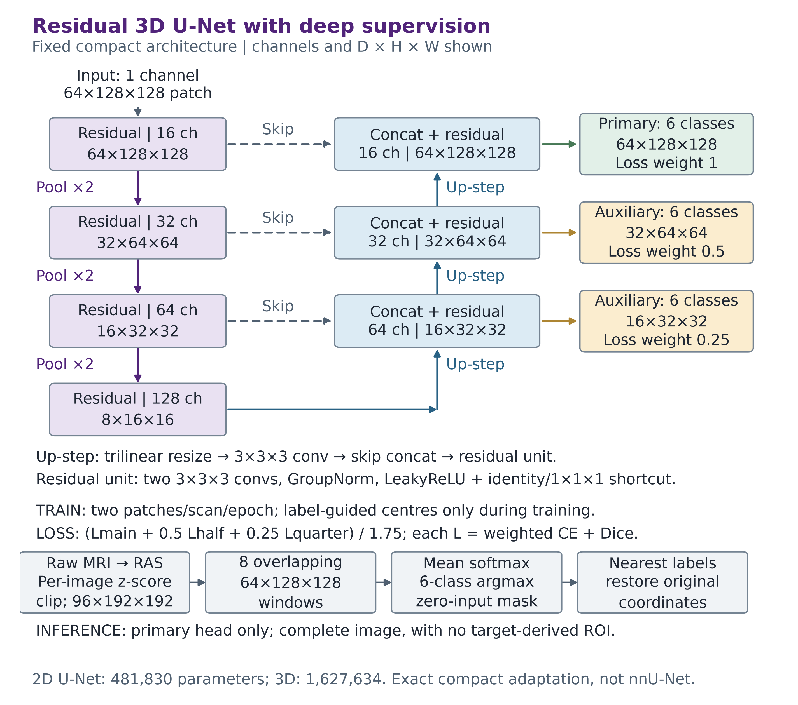

The diagram shows a training patch. At inference the eight windows cover the complete 96 x 192 x 192 image. The 64 x 128 x 128 reporting grid spans that complete physical field of view; it is a different physical grid from a training patch despite having the same array dimensions.

The six labels are mutually exclusive. Stored masks contain integer IDs; the Dice loss creates a one-hot representation internally, while cross-entropy uses categorical targets. Softmax probabilities produce one final label per voxel. Complete 3D prediction averages the probabilities from eight overlapping windows, including every voxel, before argmax; it does not average class IDs. Complete 2D prediction assembles every slice. An image-only zero-support policy is fixed for both models. No target-defined ROI or organ location enters prediction.

Each original image is reoriented to canonical RAS, standardized using its own nonzero intensities, clipped to [-5, 5] and linearly resampled to the input grid. Labels use nearest neighbours. Voxel-centre-aware affines retain the physical field of view; native-coordinate output uses the original image geometry. Paired H/W flips are restricted to training. The class weights use inverse-square-root frequencies from complete TRAIN grids, followed by fixed clipping and normalization; no sampled, VAL or TEST counts determine them.

The original course copy was transferred without substituting a different archive: all **422 files** matched the source byte length and SHA256 ([migration receipt](evidence/raw_source_migration.json)). The fresh TRAIN/VAL audit verified **143/38 scans from 26/6 disjoint patients**, all six training classes, 362 source-file identities and complete preparation checks. Before fixed selection, TEST has only filename/split entries and no decoded arrays in the cache ([audit](evidence/fresh_trainval_audit.json)). Prostate occupies approximately **0.108% of TRAIN grid voxels**, which motivates class weighting and foreground sampling. Sampling is applied across all five foreground classes rather than to a particular held-out patient.

### Fixed training protocol and optimization trace

| Setting | 2D baseline | 3D Improved U-Net |
|---|---|---|
| Seed / epochs | 3711 / 30 | 3711 / 30 |
| TRAIN input | 32 slices per scan/epoch | 2 patches per scan/epoch |
| Batch size / shape | 16 / 192 x 192 | 1 / 64 x 128 x 128 |
| Optimizer | AdamW, lr 0.001, weight decay 0.0001 | Same |
| Gradient clipping / AMP | Norm 5 / enabled | Same |
| Sampling / augmentation | 50% space, 50% foreground class; paired H/W flips | Same policy |
| Scheduled VAL epochs | 1, 5, 10, 15, 20, 25, 30 | Same |
| Selection | Maximum patient-balanced prostate Dice on 96 grid; earliest tie | Same |

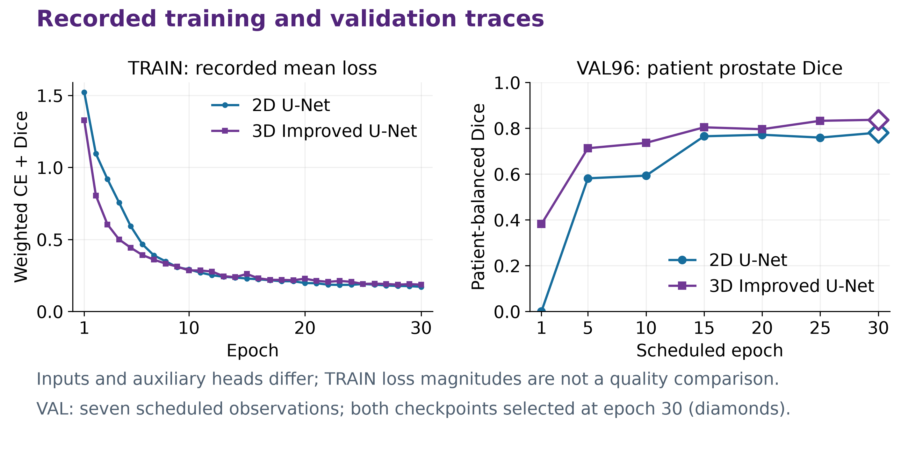

The right panel shows the actual seven VAL measurements, with both selected epochs at 30. Selection-grid VAL Dice was .78093 for 2D and .83706 for 3D. On the common 64 reporting grid, final VAL Dice was .78388 and .83510; these are different resampling grids, not different selected weights. TRAIN loss is an optimization trace under different samples and auxiliary heads, not a direct accuracy comparison. Deterministic algorithms were requested with warnings permitted; CUDA reported non-deterministic loss/pooling operations, so bitwise retraining is not promised.

## Evaluation definitions

For each class, Dice is `2TP / (2TP + FP + FN)` and IoU is `TP / (TP + FP + FN)`, without smoothing. A class absent from both masks is undefined; one-sided absence scores zero and retains the missed or extra voxel counts. The primary score averages visits within each patient and then weights patients equally. It does not pool all voxels or give patients with more visits greater weight. Defined-case and patient support accompany summaries.

Both frozen models are scored on the same reporting grid. Boundary analysis uses six-neighbour surfaces and the 95th percentile of the combined bidirectional nearest-surface distances, in physical millimetres. Empty surfaces have undefined distance rather than zero; comparisons use the same eligible visits in both models and report their support. Inferior/middle/superior regions are descriptive thirds of the GT prostate's D-axis extent, not expert anatomical apex/base annotations. Post-hoc image panels and region definitions are analysis tools and are never inference inputs.

Additional saved-array analysis counts prostate false positives inside GT bladder and rectum, records the predicted class of prostate misses, and describes six-neighbour components and missed GT-positive slices. The same five worst-patient case choices are shown in coronal/sagittal views with complete D-axis area curves. These are descriptive error analyses with explicit denominators, rather than a new model selection or a validated clinical routing rule. An empty prediction retains its zero overlap; it cannot earn a favourable continuity conclusion merely by being smooth.

This is a comparison of two complete configurations. Equal epochs and attempted update counts do not make their computation equal: dimensionality, parameter count, sampled voxels, supervision and inference differ. Actual optimizer updates and AMP overflow skips are recorded separately. A single-seed comparison cannot isolate the causal effect of 3D context or establish clinical safety. Final recommendations must consider all patients and boundary errors alongside measured runtime and memory.

## Formal quantitative results

Full anonymous [per-class](results/class_comparison.csv), [per-case](results/case_metrics.csv) and [per-patient](results/patient_metrics.csv) tables accompany the report. No spatial label or prediction arrays are distributed in Git.

Both fresh models completed the fixed 30 epochs with seed 3711 and selected epoch 30 using scheduled validation prostate Dice. Evaluation used the same 30 TEST scans from six patients and the same 64 × 128 × 128 reporting grid. The primary average first averages visits within each patient, then gives the six patients equal weight. These patients were separated from TRAIN, but the cohort had been explored during earlier development; this is not a newly independent blind benchmark.

The 3D pipeline achieved primary prostate Dice **0.78530**, compared with **0.69048** for 2D, an absolute gain of **0.09483**. The declared average target of 0.70 was met. All six patient means improved, although M015 and W029 remained below 0.70. Dice improved in 28/30 visits; M020 Week1 and Week2 declined slightly, from .877615 to .877561 and .859251 to .855087 respectively. A successful average therefore does not imply success in every scan.

| Class | 2D Dice | 3D Dice | 2D IoU | 3D IoU |
|---|---:|---:|---:|---:|
| Background | .9834 | .9797 | .9680 | .9608 |
| Body | .9639 | .9606 | .9309 | .9248 |
| Bones | .8565 | .8766 | .7501 | .7815 |
| Bladder | .8691 | .8764 | .7767 | .7924 |
| Rectum | .7670 | .7803 | .6299 | .6618 |
| Prostate | .6905 | .7853 | .5442 | .6596 |

Body and background overlap declined slightly. The patient-balanced foreground mean Dice was .82941 for 2D and .85584 for 3D; background was excluded. The prostate result is not substituted by this larger foreground average.

| Prostate aggregation | 2D Dice | 3D Dice | Interpretation |
|---|---:|---:|---|
| Patient-balanced | .69048 | **.78530** | Prespecified primary result |
| Equal scan mean | .65112 | .74565 | Secondary; patients with more visits receive more weight |
| Pooled voxel counts | .67057 | .75658 | Secondary; larger masks and repeated visits receive more weight |

Both secondary 3D summaries also exceeded .70. They do not replace the primary definition.

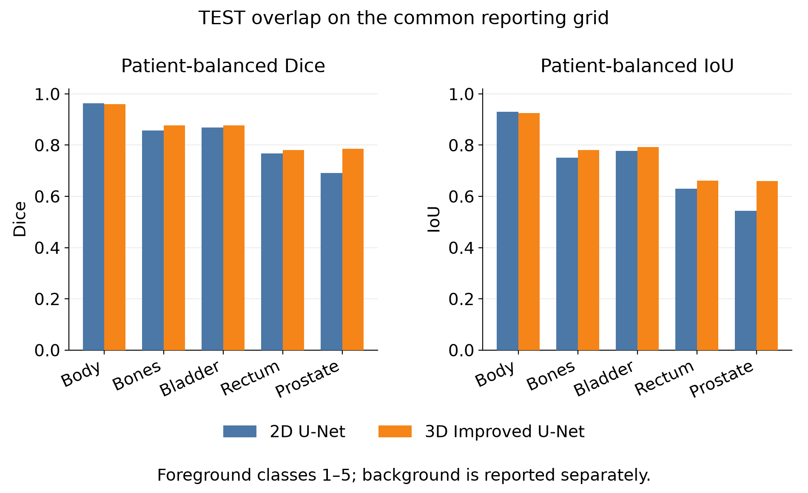

| TEST patient | Visits | 2D prostate Dice | 3D prostate Dice |
|---|---:|---:|---:|
| B037 | 1 | .6906 | .7937 |
| L011 | 8 | .7958 | .8457 |
| M015 | 8 | .4752 | .6108 |
| M020 | 4 | .8576 | .8695 |
| W029 | 8 | .5601 | .6933 |
| W041 | 1 | .7636 | .8987 |

## Boundary accuracy, organ interfaces and continuity

HD95 uses six-neighbour surfaces and the 95th percentile of combined bidirectional nearest-surface distances in physical millimetres. Both models had defined surfaces for every class in all **30 scans and six patients**, so every comparison below has identical support. Means use equal visits within patient, then equal patients. Empty surfaces would remain undefined rather than being assigned zero distance.

| Class | 2D HD95 (mm) | 3D HD95 (mm) |
|---|---:|---:|
| Background | 6.6909 | 13.8240 |
| Body | 12.8616 | 11.7979 |
| Bones | 7.5713 | 6.5549 |
| Bladder | 18.1445 | 8.3079 |
| Rectum | 10.8293 | **19.0705** |
| Prostate | 8.5169 | 6.3896 |

Prostate HD95 improved in 25 visits, worsened in two and tied in three. However, rectum HD95 worsened despite its higher average Dice. This is a concrete warning against using overlap alone to judge boundary utility.

The following descriptive regions divide the inclusive GT prostate D-axis extent into three parts. They are not expert annotations of the anatomical apex or base. Each region retains its full H/W plane; false positives outside the GT D extent still count in global scores but are outside this regional summary. All regions have 30 scans/six patients of defined support.

| GT D-extent region | 2D Dice | 3D Dice | 2D IoU | 3D IoU |
|---|---:|---:|---:|---:|
| Inferior third | .7347 | .7947 | .6001 | .6737 |
| Middle third | .7588 | .8268 | .6289 | .7161 |
| Superior third | .4652 | .6998 | .3511 | .5675 |

The largest regional gain was in the superior third, but it remained weaker than the middle. All 30 3D prostate predictions formed one six-connected component; eight 2D scans had multiple components. Completely missed GT-positive D slices decreased from **68 to 17**, affecting **26 versus nine scans**. These findings support improved continuity, not guaranteed anatomical correctness: a connected contour can still be too small, too large or misplaced.

Patient-balanced prostate FN rate decreased from **26.39% to 18.31%**, and FP fraction among predicted prostate decreased from **23.51% to 19.78%**, each using 30 scans/six patients. The following pooled counts are secondary descriptive evidence, not independent patient observations.

| Error category | 2D voxels / stated denominator | 3D voxels / stated denominator |
|---|---:|---:|
| All prostate FN / GT prostate | 10,470 / 27,319 | 7,499 / 27,319 |
| All prostate FP / predicted prostate | 6,085 / 22,934 | 5,255 / 25,075 |
| Prostate FP inside GT bladder / all prostate FP | 291 / 6,085 | 270 / 5,255 |
| Prostate FP inside GT rectum / all prostate FP | 75 / 6,085 | 44 / 5,255 |
| GT prostate assigned bladder / GT prostate | 1,734 / 27,319 | 668 / 27,319 |
| GT prostate assigned rectum / GT prostate | 67 / 27,319 | 232 / 27,319 |

Most remaining 3D prostate FN voxels were assigned to body (6,547/7,499). The increased prostate-to-rectum confusion, including 204 voxels in M015, must also remain visible. Whole-organ overlap does not measure the safety of a thin rectal or bladder wall.

**M015 exposes a separate multi-organ failure.** Its rectum patient Dice decreased from .6045 to .4537, while HD95 increased from **23.7161 to 87.0791 mm**. Across its eight visits, GT bladder assigned rectum increased from **15/48,305 (0.0311%) to 4,757/48,305 (9.8478%) voxels**. In Week2, the count was 0 versus 297/3,801 bladder voxels. The 3D rectum prediction contained five components; 347 FP voxels were over 50 mm from the GT rectum surface, including 342 over 80 mm. Its HD95 was **102.7888 mm**. These directly observed distant, wrongly labelled components explain the large surface-distance penalty; they do not establish why the network produced them or identify a unique MRI/training cause.

## Five observed failure cases

The five cases are reproducibly selected: the five lowest 3D patient means, followed by each patient's worst 3D visit. Axial planes show the largest 3D prostate FP+FN area, selected post hoc. Numbers below describe entire report-grid volumes, not just the displayed plane. Spatial views use post-hoc GT-selected planes; they never guide inference.

| Case | 2D Dice | 3D Dice | FP, 2D → 3D | FN, 2D → 3D |
|---|---:|---:|---:|---:|
| M015 Week0 | .4516 | .4886 | 0 → 109 | 889 → 814 |
| W029 Week3 | .5107 | .6095 | 461 → 243 | 18 → 44 |
| B037 Week0 | .6906 | .7937 | 114 → 269 | 1,449 → 915 |
| L011 Week2 | .7984 | .8226 | 298 → 301 | 54 → 16 |
| M020 Week0 | .8250 | .8447 | 131 → 227 | 225 → 120 |

**M015 Week0 — persistent under-contouring.** The worst 3D visit still misses **814/1,255 GT prostate voxels**. GT occupies D28–42, compared with D29–38 for 2D and D29–40 for 3D. Both predicted peak areas are about 858 mm² against GT 1,445 mm². The spatial views also expose wrong rectum labels near GT bladder. This patient requires substantial manual correction despite the average improvement.

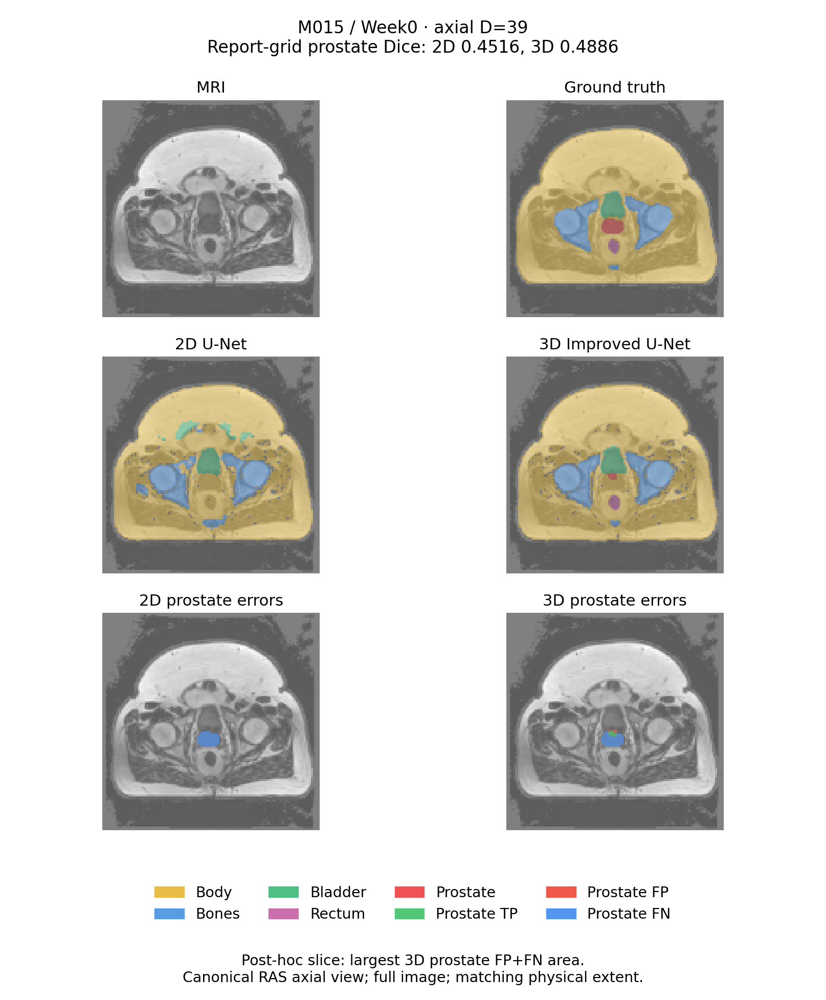

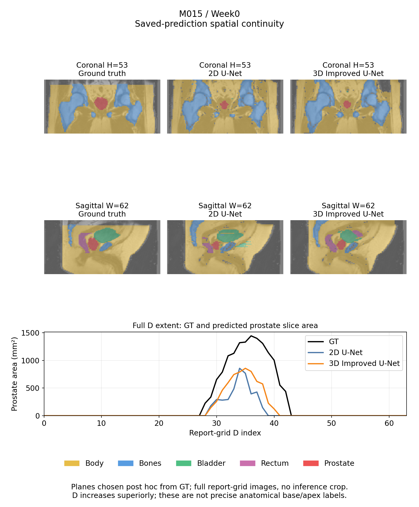

**W029 Week3 — less over-contouring with a recall trade-off.** 3D reduces the large FP surround, but increases FN. Its peak area remains about 779 mm² against GT 519 mm²; 2D reaches about 1,185 mm². Thus, improved overlap does not eliminate excessive contour area. [Spatial views and area curve](figures/continuity_W029_Week3.png).

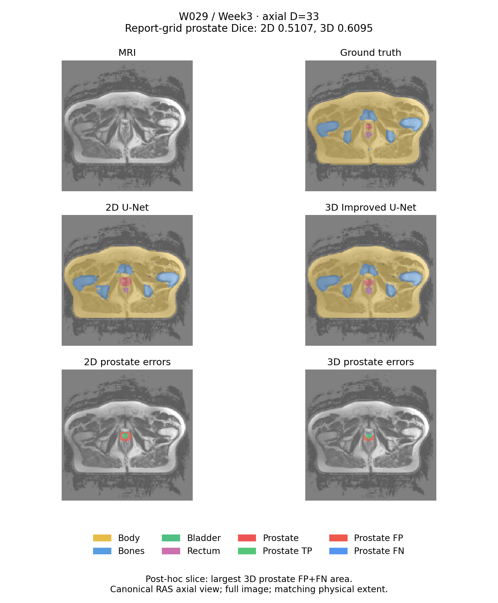

**B037 Week0 — superior extent remains incomplete.** 3D recovers more prostate, reducing FN substantially, but adds FP. GT peak area is about 3,086 mm², versus 1,982 for 2D and 2,227 for 3D. The axial blue FN area and earlier decline of the predicted area curves show continuing under-contouring at higher D positions. GT prostate assigned bladder decreases from 591 to 369 voxels, but remains substantial.

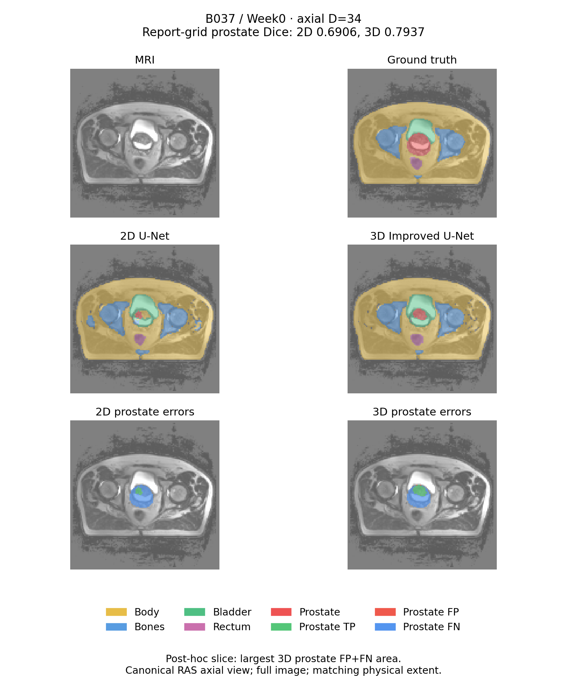

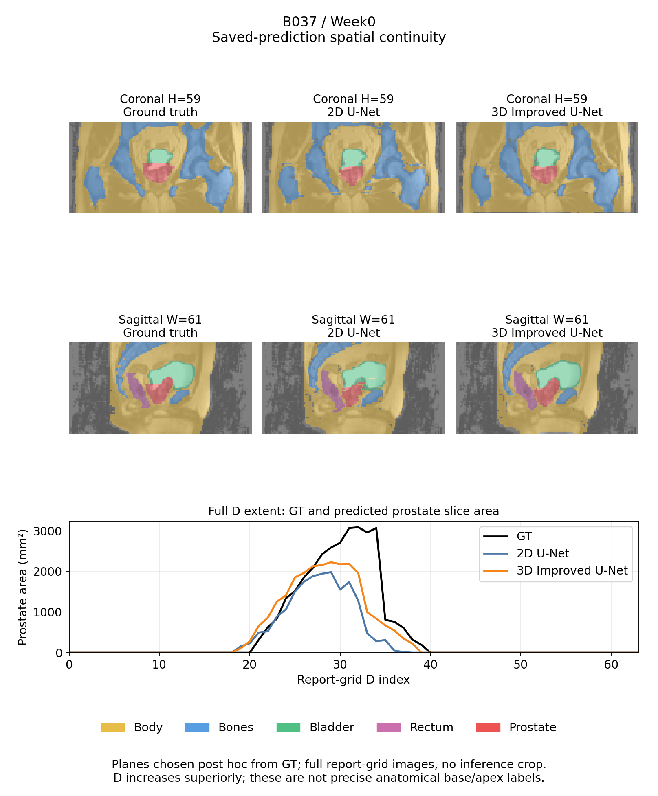

**L011 Week2 — fewer misses without removing FP.** The 3D model recovers most missed prostate while leaving approximately the same FP count. Both predictions extend inferiorly beyond the first GT-positive D plane. A smoother area profile therefore still requires boundary correction. [Spatial views and area curve](figures/continuity_L011_Week2.png).

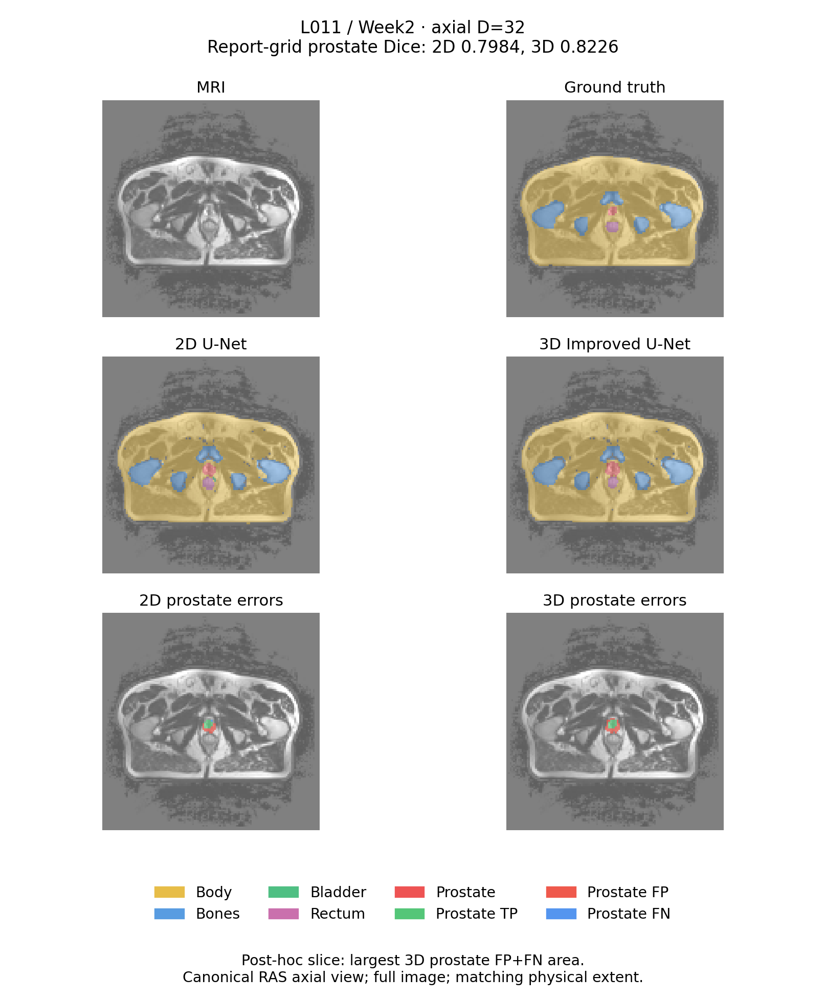

**M020 Week0 — Dice improves while boundary distance worsens.** The added coverage lowers FN but raises FP, including FP inside GT bladder from eight to 26 voxels. Prostate HD95 increases from **4.4194 to 5.4098 mm** despite higher Dice. This is a direct counterexample to treating an overlap improvement as a boundary-safety guarantee. [Spatial views and area curve](figures/continuity_M020_Week0.png).

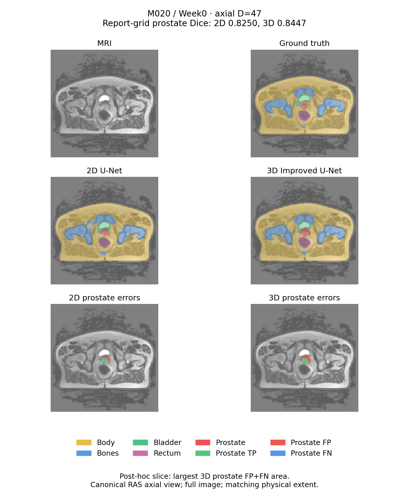

## Resource cost and engineering recommendation

Measurements use one NVIDIA L40S. Training wall time includes data handling, validation, checkpoints and training-curve generation. Warm whole-volume latency includes network execution, transfers and window averaging, but excludes disk loading, preprocessing and export. CUDA memory means peak allocated memory, not total GPU usage.

| Resource | 2D U-Net | 3D Improved U-Net |
|---|---:|---:|
| Parameters | 481,830 | 1,627,634 |
| Training run wall time | 696.12 s | 1,857.38 s |
| Peak training allocation | 347.46 MiB | 2,281.16 MiB |
| Mean warm whole-volume latency | 27.36 ms | 639.58 ms |
| Peak inference allocation | 334.86 MiB | 1,790.54 MiB |
| Attempted training batches | 8,580 | 8,580 |
| Successful optimizer updates | 8,575 | 8,577 |
| Recorded AMP skips | 5 | 3 |

The 3D pipeline costs about **2.67× training wall time, 6.57× training allocation and 23.37× warm inference latency**. Its training input volume is 1.7778× larger. Equal planned batches therefore do not imply equal computation. Both remain within one-GPU resources; the recorded study pipeline took 57.27 minutes, excluding earlier transfers/readiness and subsequent boundary reporting.

**Recommendation:** advance 3D only as the stronger candidate for further research on manually reviewed prostate drafts when its measured resource cost is acceptable; retain 2D as an inexpensive comparison and research fallback. The 3D gains in superior-region overlap and continuity are useful, but they do not justify unattended multi-organ contours. Require specialist review of complete organ extent and bladder/rectum interfaces in every case. No validated prediction-only rule currently identifies all dangerous cases, and actual correction-time savings were not measured.

The evidence is limited to one seed, six TEST patients with correlated visits, a previously explored cohort and a downsampled grid of approximately 3.12–3.59 mm spacing. Restoring coordinates does not recover native detail. Network architecture and normalization layers, training samples and auxiliary losses differ between pipelines, so this comparison cannot isolate a causal effect of 3D context alone. The met average target establishes coursework performance under the declared metric, not clinical deployment readiness.

## Reproduction

Use a CUDA-enabled PyTorch environment for the formal study. The observed Linux/Python 3.10 GPU package versions are pinned in requirements-gpu.txt; requirements.txt lists the cross-platform dependencies. A CPU can run the synthetic checks and image-only predictor. Set up an isolated environment and run:

```bash
python -m pip install -r requirements.txt
python -m unittest discover -s tests -v
python tools/check_runtime.py --config config.json --output artifacts/gpu_readiness.json
```

The course raw directory must contain semantic_MRs/*_LFOV.nii.gz and semantic_labels_only/*_SEMANTIC.nii.gz. Preserve the course patient identifiers; the inventory must exactly match patient_split.json. With a passing preflight and a new WORK_DIR, execute the fixed sequence:

```bash
python tools/run_study.py \
  --raw-root /path/to/HipMRI_Study_open \
  --work-dir artifacts/fixed_run \
  --gpu-readiness artifacts/gpu_readiness.json
```

The runner prepares TRAIN/VAL, trains each model from scratch, freezes both VAL-selected checkpoints, prepares TEST, performs paired reporting and independent saved-prediction analysis, then demonstrates raw-image-only native-coordinate output. Logs and study_state.json identify actual completed phases. Existing output directories are rejected. This is a fixed run, with no search over seeds, settings or additional candidates. Failed partial runs must be retained and investigated rather than described as completed.

For an independent image, the prediction entry below delegates to predict.py and prints the result paths and timing. It needs an MRI and a selected checkpoint; it accepts no target mask:

```bash
python tools/predict_and_report.py --image /path/to/scan.nii.gz \
  --checkpoint artifacts/fixed_run/improved3d/best.pt \
  --config config.json --output-dir artifacts/new_prediction --device cuda
```

It saves an integer native-grid NIfTI, a model-grid prediction, a prediction-only overlay and a geometry/hash receipt. Coordinate restoration cannot recover detail lost during resizing. Formal evaluation uses the declared common reporting grid, rather than claiming native-resolution accuracy.

To inspect a completed prediction without rerunning inference, use `python tools/predict_and_report.py --receipt artifacts/new_prediction/prediction_receipt.json`. The mandatory predict.py module also retains its direct file-producing CLI.

### Inference weights

Download the two selected inference checkpoints as the [inference ZIP](https://github.com/Jack-hithub/PatternAnalysis-2026/releases/download/demo3-hipmri-rebuild-seed3711-v1/demo3_hipmri_rebuild_seed3711.zip) from the [fixed-study release](https://github.com/Jack-hithub/PatternAnalysis-2026/releases/tag/demo3-hipmri-rebuild-seed3711-v1). The archive `demo3_hipmri_rebuild_seed3711.zip` is **8,157,547 bytes**, with SHA256 `383d661dba6b4b9e0ef5e9eba6936a0e0941c1d9b557bf9acd9b0eb4f872e335`. An unauthenticated HTTP 200 download matched that length and checksum. The [package manifest](results/weights_manifest.json) records its scope and verification.

Its explicit whitelist contains the two inference checkpoints, exact source/configuration, observed GPU dependencies, the repository license and anonymous run summaries. Only optimizer/scaler states were removed, and every remaining field and all 94 model tensors were compared exactly with the original selected checkpoints. The package contains no MRI, label or prediction arrays. Unzip it and follow `INFERENCE_INSTRUCTIONS.md`; the source files and configuration belong together for checkpoint verification.

Weights support raw-image-only inference. Reproducing the full fixed training study creates its own cache/run receipts; the preserved execution checksums identify this particular recorded run, and bitwise retraining is not promised. The [execution summary](results/execution_summary.json) records actual versions, training costs and selected checkpoints.

### Raw-image-only functional example

The fixed workflow predicted `B006_Week0_LFOV.nii.gz` without a GT input. It restored integer labels to the original **256 x 256 x 128** grid and original affine/qform/sform, then verified the exported NIfTI geometry. This is a TRAIN example demonstrating the inference interface and coordinate restoration; its image is not evidence of TEST accuracy. The cold inference time was 1.013 s, excluding preprocessing and export, and is distinct from the warmed TEST averages above.

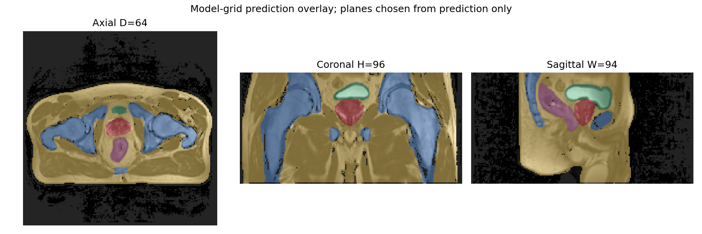

The overlay planes are selected from prediction alone. The program also writes `prediction_native.nii.gz`, `prediction_model_grid.npz` and `prediction_receipt.json`. Full arrays are kept outside Git.

### Exporting this report

The optional document environment is pinned separately in `requirements-report.txt`. With the report sources and images present, run:

```bash
python -m pip install -r requirements-report.txt
python tools/render_readme.py --source README.md \
  --output Demo3_README_Report.pdf
python tools/render_feasibility.py --source FEASIBILITY.md \
  --output Demo3_Feasibility_Plan.pdf
```

The PDF must be visually checked after content changes. The coursework submission is a PDF export of this README, accompanied by the working source PR. The physical tutor check-off, LMS upload and later teaching-team review response are separate completion steps.

## Feasibility review

Baoxu Wang (s4927782), COMP3710 — 28 October 2026. Written before the formal execution described here.

**Problem and user.** A pelvic MRI reviewer needs initial contours for body, bones, bladder, rectum and prostate. The model produces draft categorical segmentations for manual correction. This is a coursework prototype; clinical suitability is not established.

**Question and acceptance criteria.** Compare a compact residual 3D U-Net with deep supervision against a standard 2D U-Net. Five testable criteria are: (1) 211 aligned pairs with patient-disjoint splits; (2) prostate Dice at least 0.70, averaging visits within patient then patients equally; (3) raw-image-only prediction with valid class IDs and restored original coordinates; (4) one GPU, 30 epochs per model and no additional candidates, recording time and memory; (5) paired class metrics and five distinct-patient boundary error examples. A favourable average must not hide a failed patient. No minimum VAL improvement over the baseline is imposed.

**Data and separation.** The course HipMRI copy has 211 paired scans from 38 patients. Fixed TRAIN/VAL/TEST assignments contain 26/6/6 patients and 143/38/30 scans. Keep every patient's visits together. The official CSIRO label key identifies prostate as class 5. Use the course files without substituting a different archive. The cohort was explored during earlier development, so this execution is patient-disjoint but does not establish a new blind test.

**Fixed method.** Canonical RAS orientation, per-image nonzero z-score and clipping, then a 96 x 192 x 192 grid. Interpolate images linearly and labels with nearest neighbours. Train two 64 x 128 x 128 patches per scan for 3D, or 32 slices per scan for 2D. Half of TRAIN sample centres are spatially uniform; half select a foreground class and voxel. Neither inference nor validation uses target-derived cropping. The 3D model has 1,627,634 parameters; 2D has 481,830. Both use weighted categorical cross-entropy plus Dice, 30 epochs, seed 3711 and the fixed optimizer in config.json. Scheduled VAL prostate Dice selects each checkpoint, taking the earliest tie. Freeze both choices before final TEST evaluation. No further candidate is planned.

**Resources and checks.** A single GPU Lab NVIDIA L40S is available. Synthetic full-shape CUDA checks passed before real-data training: about 2.23 GiB peak allocated memory for a 3D training patch and 0.34 GiB for the 2D batch. These are readiness measurements, not formal task costs. CPU integration checks cover geometry, patient separation, metrics, freezing, full-image inference and raw-image-only output. Allow roughly 25 minutes for preparation and 100 minutes for the formal pair as planning estimates; record actual time and memory. The pipelines share an attempted-update budget; actual AMP skips are recorded. Computation is not equal.

**Evaluation, risks and fallback.** Score both models on the same 64 x 128 x 128 grid. Save all cases, independently recount overlap, and compare boundary distances on common eligible support. Show MRI, target, both predictions and FP/FN; distinguish observed errors from unverified causes. Small patient counts, previously explored TEST data, downsampling, one seed and pipeline differences limit generalization and causal conclusions. If 3D cannot complete within available resources, retain the measured 2D prototype and exact failure record rather than claiming a successful 3D result. Unsafe contours require manual correction; neither model is approved for unattended clinical use. Publish source and anonymous report material; keep raw arrays and weights outside Git.

References: [U-Net](https://arxiv.org/abs/1505.04597); [residual/deep-supervision reference](https://arxiv.org/abs/1802.10508), implemented as an adaptation; [CSIRO HipMRI](https://doi.org/10.25919/45t8-p065); [official label key](https://data.csiro.au/dap/ws/v2/collections/52549/support/5034).

## References

- Ronneberger et al., U-Net (2015): https://arxiv.org/abs/1505.04597.
- Isensee et al., residual units/deep supervision architectural reference: https://arxiv.org/abs/1802.10508. The implementation is an adaptation, not a claim of exact nnU-Net reproduction.
- HipMRI, Dowling and Greer, CSIRO v2: https://doi.org/10.25919/45t8-p065. Official labels 0 background, 1 body, 2 bones, 3 bladder, 4 rectum and 5 prostate are preserved in label_schema.json.
